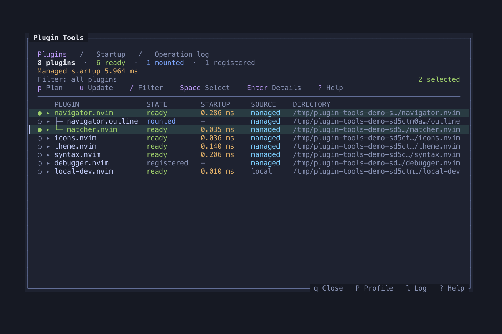
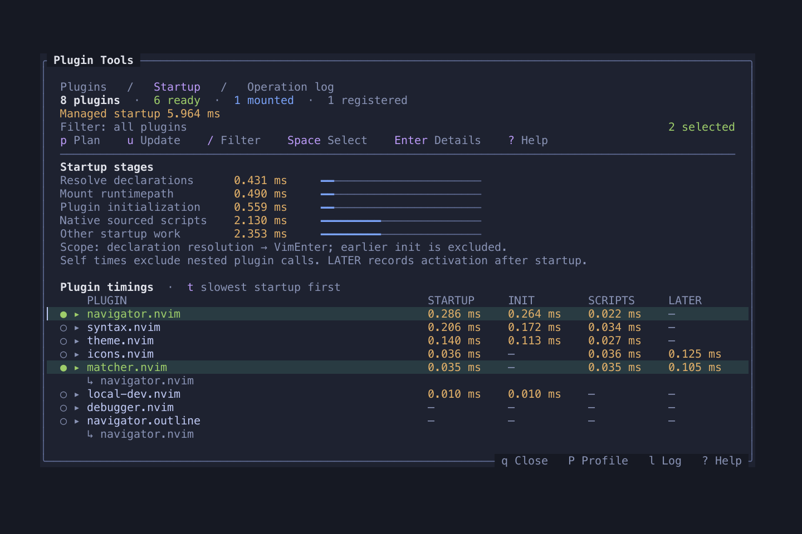
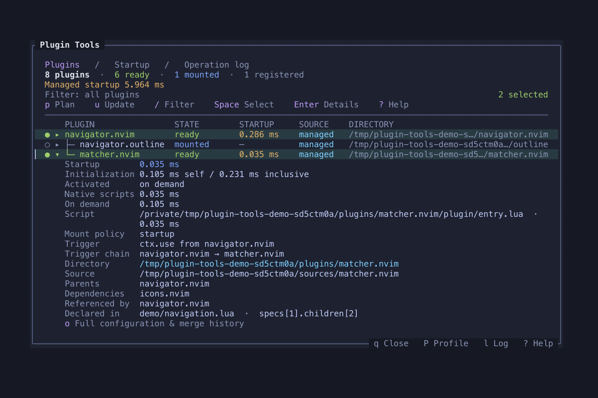
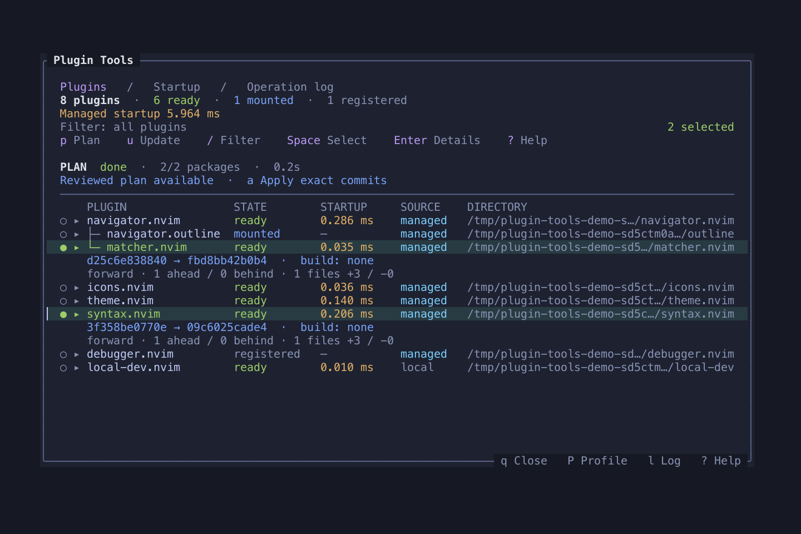

# plugin-tools.nvim

Explicit plugin composition, package installation and runtime mounting.

## Features

- Inspect plugin ownership, activation reasons and timings.
- Install exact locked revisions and review updates before applying them.
- Keep package management separate from feature initialization.
- Bootstrap from init.lua and manage plugin-tools.nvim's own locked revision.

<table width="100%">
  <tr>
    <td width="50%" align="center">
      <strong>Plugin hierarchy and activation states</strong><br>
      <a href="doc/screenshots/overview.png"></a>
    </td>
    <td width="50%" align="center">
      <strong>Startup profiling</strong><br>
      <a href="doc/screenshots/profile.png"></a>
    </td>
  </tr>
  <tr>
    <td width="50%" align="center">
      <strong>Dependencies and declaration origins</strong><br>
      <a href="doc/screenshots/details.png"></a>
    </td>
    <td width="50%" align="center">
      <strong>Review updates before applying</strong><br>
      <a href="doc/screenshots/update-plan.png"></a>
    </td>
  </tr>
</table>

Captured from an isolated offline demo. [Recreate the screenshots](doc/screenshots/README.md).

## Requirements

Neovim **0.11+**. Git is required for installation and updates. Startup installs
missing managed plugins by default; set `auto_install = false` to disable this.

## Installation

Save the configuration table below as `lua/plugins.lua` inside your Neovim
configuration directory. Put this loader in `init.lua`, before loading plugins:

```lua
local opts = require("plugins")
local root = opts.root or (vim.fn.stdpath("data") .. "/plugin-tools")
local path, seed = root .. "/plugin-tools.nvim", nil
local ok, manager = pcall(function()
  if not vim.uv.fs_lstat(path) then
    seed = vim.fn.tempname()
    local result = vim.system({
      "git", "clone", "--filter=blob:none", "--",
      "https://github.com/Jacky-Lzx/plugin-tools.nvim.git", seed,
    }, { text = true }):wait(120000)
    assert(result.code == 0, result.stderr)
  end
  return dofile((seed or path) .. "/bootstrap.lua").setup(opts)
end)
if seed then vim.fn.delete(seed, "rf") end
if not ok then error(manager, 0) end
```

`lua/plugins.lua` contains the manager's own `opts` table and plugin declarations:

```lua
-- lua/plugins.lua
local opts = {
  -- Options for plugin-tools.nvim itself.
  root = vim.fn.stdpath("data") .. "/plugin-tools",
  lockfile = vim.fn.stdpath("config") .. "/plugin-tools-lock.json",
  auto_install = true, -- Install missing managed plugins before configuration.
  strict = true, -- Report any remaining missing directories.
  commands = true, -- Register :PluginTools.
  profile = true, -- Measure startup and on-demand activation.
  concurrency = 4, -- Maximum parallel package workers.
  git_timeout = 120000, -- Timeout per Git command, in milliseconds.
  self = { source = "Jacky-Lzx/plugin-tools.nvim", version = "main" },

  specs = {
    {
      id = "file-tools.nvim",
      source = "Jacky-Lzx/file-tools.nvim",
      main = "file_tools",
      -- These options are passed to require("file_tools").setup().
      opts = { tree = { width = 36 } },
    },
  },
}
return opts
```

The top-level `opts` configures plugin-tools.nvim; each declaration's `opts`
configures that plugin. Bootstrap registers plugin-tools.nvim automatically, so
do not add it to `specs`. `self` selects its managed source and revision.
With this example, `:FileTools toggle` opens the configured file tree.

The temporary clone installs the managed copy and declared packages through the
normal transaction and lockfile workflow, then is removed. Subsequent startups
automatically install newly declared or deleted managed packages before loading
your plugin configuration. Existing plugins are not updated. When packages are
present, startup runs no Git commands and does not read the lockfile. Keep
`plugin-tools-lock.json` with your configuration to reproduce revisions.

`auto_install` defaults to `true` for both bootstrap and ordinary `setup()`.
Set it to `false` in the setup options to install packages explicitly with
`:PluginTools install`; use `strict = false` to enter Neovim with missing plugins.

Update plugin-tools.nvim itself with `:PluginTools update plugin-tools.nvim`, or
include it in `:PluginTools plan` followed by `:PluginTools apply`. Restart after
updating. See the [bootstrap guide](doc/guide.md#bootstrap-and-self-updates) for
options, failure recovery and migration.

For manual installation, clone into Neovim's native package directory:

```sh
git clone https://github.com/Jacky-Lzx/plugin-tools.nvim.git \
  "${XDG_DATA_HOME:-$HOME/.local/share}/nvim/site/pack/tools/start/plugin-tools.nvim"
```

With manual installation, call this from `init.lua`, before native plugin loading:

```lua
require("plugin_tools").setup({ specs = {} })
```

## Usage

```vim
:PluginTools
:PluginTools profile
:PluginTools explain {id}
```

## Documentation

- [Complete reference](doc/plugin-tools.txt) — `:help plugin-tools`.
- [Workflow and integration guide](doc/guide.md).
- [Plugin design, implementation and manager integration](doc/plugin-authoring.md).
- Diagnose availability with `:checkhealth plugin_tools`.

## Development

Run from the repository root:

```sh
python3 tests/run.py unit --filter docs
python3 tests/run.py default
```

Refresh the screenshots after UI changes (requires `rsvg-convert`):

```sh
python3 doc/screenshots/capture.py
```

See [the test workflow](tests/README.md) for dependencies, optional suites and
retained failure evidence. Local development overrides belong in your package
manager configuration; public installation uses the repository above.

[License](LICENSE).
